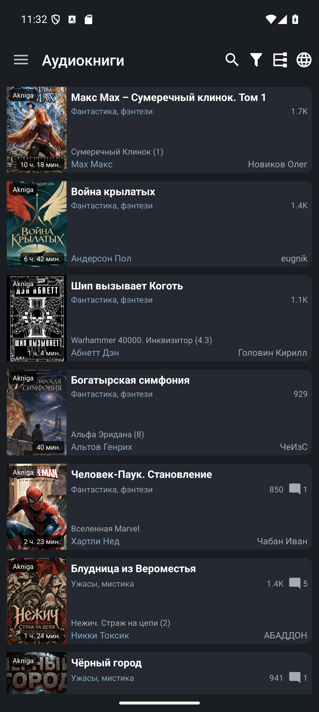
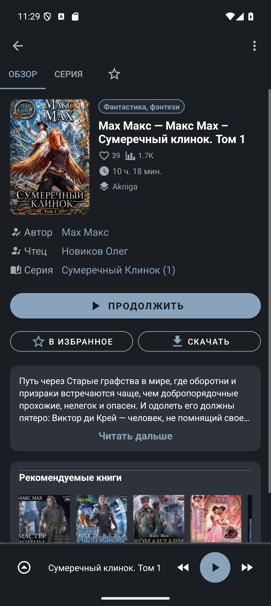
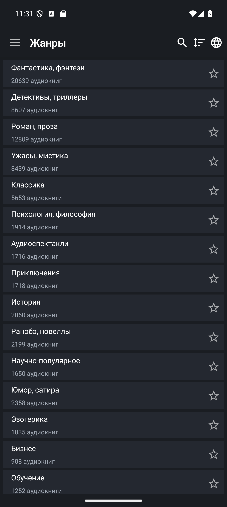
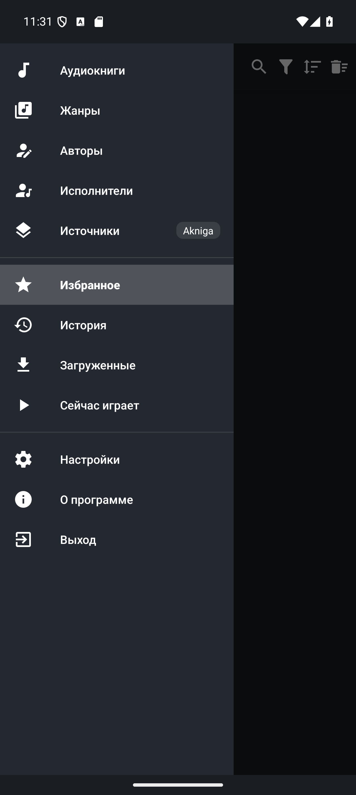
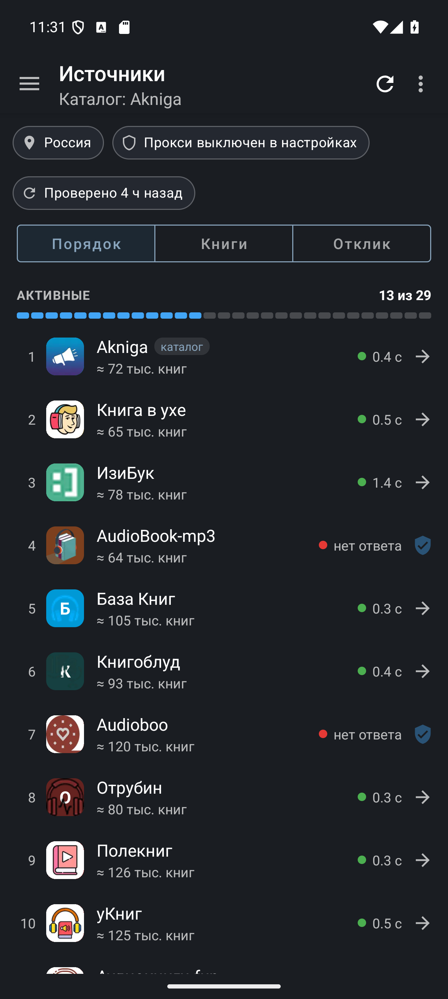
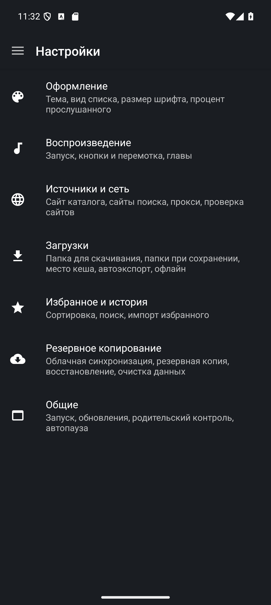

# AudioBooks

**English** · [Русский](readme.ru.md)

[](https://github.com/thejohnd0e/AudioBooks/actions/workflows/build.yml)
[](https://github.com/thejohnd0e/AudioBooks/releases/latest)
[](#requirements)


**Make room for books in your everyday life.** AudioBooks is a free Android app for discovering and listening to audiobooks from 29 online catalogs. Enjoy a story on your commute, download a book before a trip, or fall asleep listening with a sleep timer.

The idea is simple: bring book discovery, a personal library, and comfortable listening together in one place. Browse classics, science fiction, mysteries, memoirs, business and self-education titles, school curriculum books, and fairy tales and poems for children, then pick up where you left off.

[Download](#install) · [Report an issue](https://github.com/thejohnd0e/AudioBooks/issues)

<details>
<summary>Contents</summary>

- [What you can do](#what-you-can-do)
- [Book sources](#book-sources)
- [Screenshots](#screenshots)
- [Requirements](#requirements)
- [Install](#install)
- [Start listening](#start-listening)
- [Help & feedback](#help--feedback)
- [Contributing](#contributing)
- [Building from source](#building-from-source)
- [Credits](#credits)

</details>

## What you can do

- **Explore 29 audiobook catalogs.** Browse by genre, author, or narrator; search across up to 13 active sources simultaneously; explore series and recommendations where available.
- **Listen online or offline.** Stream directly or download full books and individual chapters in advance. Filter books by downloaded status and listen with zero internet connection.
- **Modern, polished interface.** Clean Material cards with duration and source badges directly on covers, 2-column grid and list view layouts, and minimal visual noise.
- **Reworked book details & player.** Large cover with soft rounded corners and shadow, one-tap direct download button, prominent listen button, collapsible synopsis, and series cards.
- **Comfortable playback bar.** Bottom player bar with enlarged touch targets (44×44dp and 48×48dp Play/Pause button with accent circle), top chapter progress indicator, playback speed control, and skip backward (10s) / forward (30s).
- **Custom color palettes & themes.** Light, Dark, and Black themes, three calming natural palettes (**Muted Sage**, **Muted Umber**, **Muted Steel**), plus a full color wheel picker for completely custom background, surface, and accent colors.
- **Personal library.** Save your favorite books, authors, and narrators; pick up where you stopped with smart listening history and progress indicators.
- **Sleep timer & equalizer.** Wind down comfortably with a sleep timer that smoothly pauses playback, and fine-tune sound with the built-in equalizer.
- **Reach blocked catalogs.** Built-in proxy for catalog pages, audio streaming, downloads, and book covers when sources are restricted in your country, complete with live latency and reachability status.
- **Big screens supported.** Fully adapted for Android smartphones, tablets, and Android TV.

## Book sources

The app connects to **29 audiobook catalogs**:

> **Akniga**, **Книга в ухе**, **ИзиБук**, **AudioBook-mp3**, **База Книг**, **Книгоблуд**, **Audioboo**, **Отрубин**, **Полекниг**, **уКниг**, **Аудиокниги.fun**, **Aknig.xyz**, **Аудиокнига Life**, **Aknigi24**, **Lis10book**, **Audiokniga.one**, **Библус**, **Audiokniga-online**, **Slushat-knigi**, **Audioknigi.pro**, **Bookish**, **Golosknig**, **Голосом**, **ЯКнига**, **BookInfo**, **Audio-kniga.biz**, **База Книг (info)**, **4Read (укр)**, and **Akniga.me**.

- Switch the browsing catalog in **Drawer → Sources** (`Источники`) or **Settings → Sources & network** (`Настройки → Источники и сеть`).
- Enable up to 13 sources for simultaneous search in **Search sources** (`Источники поиска`).
- Check catalog response times and server health in the **Sources** screen.

## Screenshots

The app interface shown below is in Russian. Select an image to view it at full size.

<table>
  <tr>
    <th>Book catalog</th>
    <th>Book details & player</th>
    <th>Genres</th>
  </tr>
  <tr>
    <td><a href="docs/assets/screenshots/books_list.png"></a></td>
    <td><a href="docs/assets/screenshots/player.png"></a></td>
    <td><a href="docs/assets/screenshots/categories.png"></a></td>
  </tr>
</table>

<details>
<summary>More screenshots: navigation, sources, and settings</summary>

<table>
  <tr>
    <th>Main menu</th>
    <th>Source management</th>
    <th>Settings</th>
  </tr>
  <tr>
    <td valign="top"><a href="docs/assets/screenshots/main_menu.png"></a></td>
    <td valign="top"><a href="docs/assets/screenshots/available_sources.png"></a></td>
    <td valign="top"><a href="docs/assets/screenshots/settings.png"></a></td>
  </tr>
</table>

</details>

## Requirements

| | |
|---|---|
| **Device** | Android phone, tablet, or TV running **Android 7.0 or later** (API 24+) |
| **Network** | Internet connection for browsing, streaming, and downloading books |
| **Storage** | Sufficient free storage for offline audiobooks |
| **App language** | Russian |
| **Package name** | `link.intertop.audiobooks` (debug: `link.intertop.audiobooks.debug`) |

## Install

1. Download `AudioBooks-<version>-release.apk` from the [latest GitHub release](https://github.com/thejohnd0e/AudioBooks/releases/latest).
2. Open the APK on your Android device and confirm installation.
3. Launch **AudioBooks** and choose your preferred catalog from **Drawer → Sources** (`Источники`) or **Settings → Sources & network** (`Настройки → Источники и сеть`).

Each release lists SHA-256 checksums in `SHA256SUMS.txt`. If you are switching from an older release signed with a different key, make a backup in **Settings → Backup** (`Настройки → Резервное копирование`), uninstall the older build, install the new APK, and restore your backup.

## Start listening

1. Browse **Audiobooks** (`Аудиокниги`) or **Genres** (`Жанры`), or search for a title, author, or narrator across multiple sources.
2. Open a book to view its synopsis, series, and recommendations. Tap the **Play** button to start listening or tap the star icon to add it to **Favorites** (`Избранное`).
3. For offline listening, tap **Download** (`Скачать`) on the book screen to download the audiobook. Switch to **Downloaded** (`Загруженные`) to view and play your offline collection without network access.
4. Continue listening anytime through **History** (`История`) — your exact chapter and second position are automatically remembered.

## Help & feedback

- **Bugs and feature requests:** [GitHub Issues](https://github.com/thejohnd0e/AudioBooks/issues). When reporting playback or download issues, please include your app version, Android version, selected source, book link, and reproduction steps.
- **Contact:** android-dev@intertop.link.

**Troubleshooting**

- **A catalog will not load:** check your network connection and try another source. If the website is blocked in your country, toggle **Proxy** in **Settings → Sources & network → Proxy** (`Настройки → Источники и сеть → Прокси`).
- **Playback stops when screen turns off:** disable battery optimization for AudioBooks in Android system settings.
- **Transferring to a new device:** export your data via **Settings → Backup** (`Настройки → Резервное копирование`); downloaded audio files should be copied separately.

## Contributing

Bug reports, translation improvements, documentation fixes, and focused pull requests are welcome. For major changes, please open an issue first to discuss your proposal. Every pull request is checked by CI (unit tests, Android lint, debug APK). Please keep the English and Russian READMEs in sync.

## Building from source

**Requirements:** JDK 17 and Android SDK Platform 36 (Android Studio provides both). The Gradle wrapper downloads Gradle 8.13 automatically.

```bash
git clone https://github.com/thejohnd0e/AudioBooks.git
cd AudioBooks
./gradlew :app:testDebugUnitTest :app:assembleDebug
```

On Windows, use `gradlew.bat`. The debug APK is built to `app/build/outputs/apk/debug/app-debug.apk` and copied to `dist/`.

- **Release builds** are signed using credentials configured in `keystore.properties` (see [`keystore.properties.example`](keystore.properties.example)).
- **Release workflow:** Pushing a version tag `v<versionName>` (e.g., `v8.5.0`) triggers the automated [Release workflow](.github/workflows/release.yml) to compile, sign, and publish the release APKs and App Bundle.
- **Developer documentation:** See [`docs/howto.md`](docs/howto.md) for toolchain details, test commands, source adapter guide, and release steps.

## Credits

**Original app developer:** fanok.inc ([fanok1](https://github.com/fanok1/AudioBooks)). Maintained and expanded by [thejohnd0e](https://github.com/thejohnd0e).
