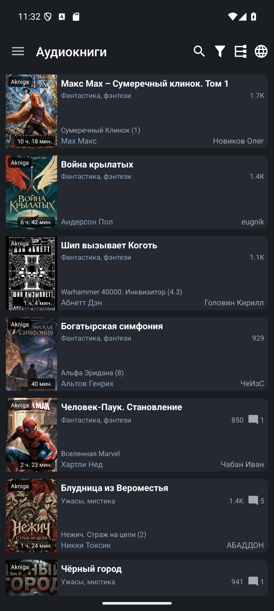
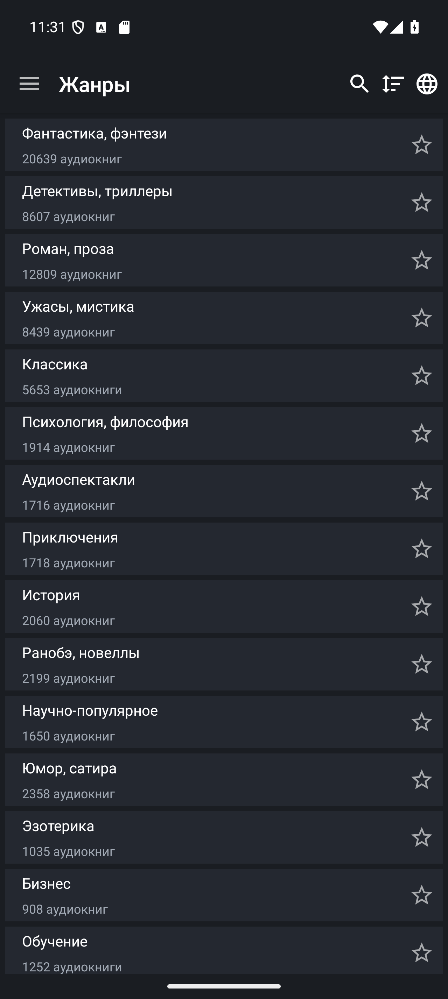
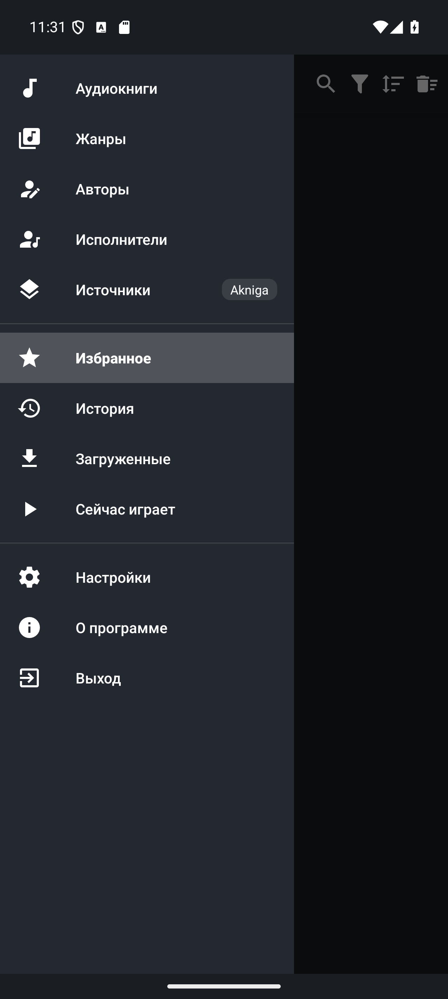
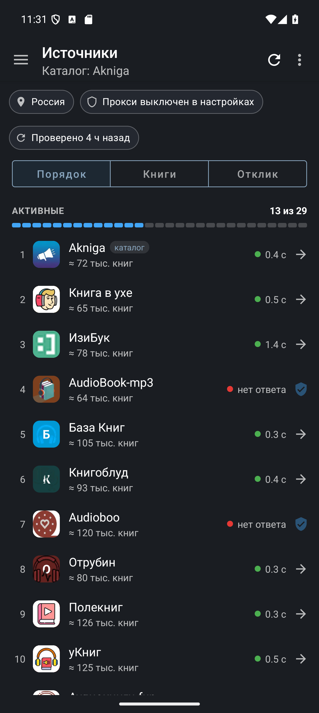
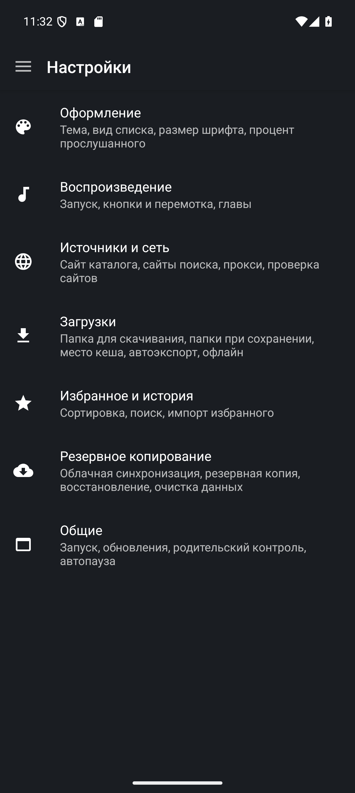

# AudioBooks

[English](readme.md) · **Русский**

[](https://github.com/thejohnd0e/AudioBooks/actions/workflows/build.yml)
[](https://github.com/thejohnd0e/AudioBooks/releases/latest)
[](#требования)


**Больше книг в вашей повседневной жизни.** AudioBooks — бесплатное приложение для Android, которое помогает находить и слушать аудиокниги из 29 онлайн-каталогов. Включайте истории по дороге на работу, скачивайте книги перед поездкой или засыпайте под любимую озвучку с таймером сна.

Идея проста: объединить поиск книг, личную библиотеку и комфортное прослушивание в одном приложении. Выбирайте классику, фантастику, детективы, мемуары, книги по бизнесу и саморазвитию, произведения школьной программы, сказки и стихи для детей, а затем продолжайте слушать с того места, где остановились.

[Скачать](#установка) · [Сообщить об ошибке](https://github.com/thejohnd0e/AudioBooks/issues)

<details>
<summary>Содержание</summary>

- [Возможности](#возможности)
- [Источники книг](#источники-книг)
- [Скриншоты](#скриншоты)
- [Требования](#требования)
- [Установка](#установка)
- [Первое прослушивание](#первое-прослушивание)
- [Сборка из исходников](#сборка-из-исходников)
- [Авторы](#авторы)

</details>

## Возможности

- **29 каталогов аудиокниг.** Просматривайте каталоги по жанрам, авторам и исполнителям, ищите одновременно по 13 выбранным источникам, знакомьтесь с сериями и рекомендациями.
- **Слушайте онлайн и офлайн.** Включайте книгу сразу или скачивайте её целиком либо по главам. Фильтруйте книги по статусу загрузки и слушайте в дороге без интернета.
- **Современный интерфейс.** Аккуратные Material-карточки со скруглёнными углами, бейджи длительности и источника прямо на обложке, переключение между сеткой (2 колонки) и списком, минимум визуального шума.
- **Обновлённый экран книги и плеер.** Крупная обложка с мягкой тенью, отдельная кнопка прямого скачивания книги в одно касание, заметная кнопка запуска, сворачиваемая аннотация и карточки серий.
- **Удобная нижняя панель плеера.** Увеличенная высота панели (68dp), крупные элементы управления (44×44dp и 48×48dp акцентная кнопка Play/Pause), тонкая линия прогресса главы сверху панели, регулировка скорости и быстрая перемотка (-10 с / +30 с).
- **Цветовые палитры и темы оформления.** Светлая, тёмная и чёрная темы, три готовые спокойные палитры (**Шалфей**, **Умбра**, **Сталь**), а также полнофункциональное цветовое колесо для тонкой настройки трёх цветов интерфейса (фон, карточки, акцент).
- **Личная библиотека.** Сохраняйте книги, любимых авторов и исполнителей; возвращайтесь к прослушиванию с точного места остановки через умную историю.
- **Таймер сна и эквалайзер.** Засыпайте с книгой благодаря плавному таймеру сна и настраивайте тембр звучания встроенным эквалайзером.
- **Обход блокировок.** Встроенный прокси для страниц каталогов, аудиопотоков, скачивания и обложек, если источник заблокирован в вашей стране, с отображением времени отклика и доступности серверов.
- **Поддержка больших экранов.** Интерфейс адаптирован для смартфонов, планшетов и Android TV.

## Источники книг

В приложении доступны **29 каталогов аудиокниг**:

> **Akniga**, **Книга в ухе**, **ИзиБук**, **AudioBook-mp3**, **База Книг**, **Книгоблуд**, **Audioboo**, **Отрубин**, **Полекниг**, **уКниг**, **Аудиокниги.fun**, **Aknig.xyz**, **Аудиокнига Life**, **Aknigi24**, **Lis10book**, **Audiokniga.one**, **Библус**, **Audiokniga-online**, **Slushat-knigi**, **Audioknigi.pro**, **Bookish**, **Golosknig**, **Голосом**, **ЯКнига**, **BookInfo**, **Audio-kniga.biz**, **База Книг (info)**, **4Read (укр)** и **Akniga.me**.

- Каталог для просмотра переключается в боковом меню в разделе **Источники** либо в **Настройки → Источники и сеть**.
- До 13 источников можно одновременно включить для мульти-поиска в разделе **Источники поиска**.
- В окне «Источники» отображается время отклика каждого сайта и статус доступности.

## Скриншоты

Нажмите на изображение, чтобы открыть его в полном размере.

<table>
  <tr>
    <th>Каталог книг</th>
    <th>Карточка книги и плеер</th>
    <th>Жанры</th>
  </tr>
  <tr>
    <td><a href="docs/assets/screenshots/books_list.png"></a></td>
    <td><a href="docs/assets/screenshots/player.png"></a></td>
    <td><a href="docs/assets/screenshots/categories.png"></a></td>
  </tr>
</table>

<details>
<summary>Ещё скриншоты: меню, источники и настройки</summary>

<table>
  <tr>
    <th>Главное меню</th>
    <th>Управление источниками</th>
    <th>Настройки</th>
  </tr>
  <tr>
    <td valign="top"><a href="docs/assets/screenshots/main_menu.png"></a></td>
    <td valign="top"><a href="docs/assets/screenshots/available_sources.png"></a></td>
    <td valign="top"><a href="docs/assets/screenshots/settings.png"></a></td>
  </tr>
</table>

</details>

## Требования

| | |
|---|---|
| **Устройство** | Смартфон, планшет или телевизор с **Android 7.0 или новее** (API 24+) |
| **Сеть** | Интернет для просмотра каталогов, онлайн-прослушивания и скачивания книг |
| **Память** | Свободное место для хранения аудиокниг офлайн |
| **Язык интерфейса** | Русский |
| **Имя пакета** | `link.intertop.audiobooks` (debug: `link.intertop.audiobooks.debug`) |

## Установка

1. Скачайте `AudioBooks-<версия>-release.apk` из [последнего релиза на GitHub](https://github.com/thejohnd0e/AudioBooks/releases/latest).
2. Откройте APK на Android-устройстве и подтвердите установку.
3. Запустите **AudioBooks** и выберите желаемый каталог в боковом меню **Источники** либо в разделе **Настройки → Источники и сеть**.

В каждом релизе опубликован файл `SHA256SUMS.txt` с контрольными суммами. Если вы переходите со старых сборок со сторонней подписью, сначала создайте резервную копию в разделе **Настройки → Резервное копирование**, удалите старое приложение, установите новый APK и восстановите данные.

## Первое прослушивание

1. Откройте **Аудиокниги** или **Жанры** либо воспользуйтесь поиском по названию, автору или исполнителю сразу по нескольким источникам.
2. Перейдите в карточку книги, чтобы прочесть описание, узнать о серии и рекомендациях. Нажмите кнопку воспроизведения или отметьте звёздочкой для добавления в **Избранное**.
3. Для прослушивания без интернета нажмите **Скачать** прямо в карточке книги. Перейдите в раздел **Загруженные**, чтобы слушать сохранённые аудиокниги в дороге.
4. В любой момент продолжайте прослушивание через **Историю** — приложение точно помнит главу и секунду остановки.

## Сборка из исходников

**Требования:** JDK 17 и Android SDK Platform 36 (входят в состав Android Studio). Gradle 8.13 загружается автоматически обёрткой Gradle.

```bash
git clone https://github.com/thejohnd0e/AudioBooks.git
cd AudioBooks
./gradlew :app:testDebugUnitTest :app:assembleDebug
```

В Windows используйте `gradlew.bat`. Отладочный APK компилируется в `app/build/outputs/apk/debug/app-debug.apk` и копируется в `dist/`.

- **Релизные сборки** подписываются ключом, параметры которого задаются в `keystore.properties` (см. [`keystore.properties.example`](keystore.properties.example)).
- **Публикация релизов:** Создание тега версии `v<versionName>` (например, `v8.5.0`) запускает автоматический [Release workflow](.github/workflows/release.yml), собирающий и публикующий APK и App Bundle.
- **Документация для разработчиков:** См. [`docs/howto.md`](docs/howto.md) (на английском): стек, тестирование, архитектура адаптеров и процедура релизов.

## Авторы

**Разработчик оригинального приложения:** fanok.inc ([fanok1](https://github.com/fanok1/AudioBooks)). Развитие и поддержка форка — [thejohnd0e](https://github.com/thejohnd0e).
